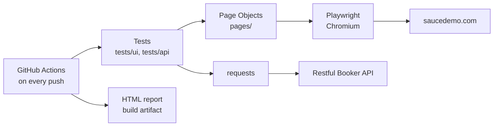

<div align="center">

# 🧪 QA Automation Demo

**End-to-end UI and API test automation with Playwright and pytest**

[](https://github.com/Ovidiu1401/qa-automation-demo/actions/workflows/tests.yml)


[Saucedemo](https://www.saucedemo.com) (demo web shop) · [Restful Booker](https://restful-booker.herokuapp.com) (demo REST API)

</div>

---

## ✨ Highlights

- **20 automated tests**: UI tests with the **Page Object** pattern and API tests with `requests`
- **8 real bugs found by exploratory testing** and documented in [BUGS.md](BUGS.md) with steps to reproduce, expected vs. actual result and severity
- **Every bug has an automated test** marked `xfail(strict=True)`: the build stays green while the bug exists and turns red the day it is fixed, so the bug list never goes stale
- **A control test** runs the same checks for a correct user and must pass, which proves the tests detect real bugs and not mistakes in the test code
- **CI on every push** with GitHub Actions and an HTML report saved as a build artifact

## 📊 Test results

| Area | Tests | What is checked |
|------|:-----:|-----------------|
| Login | 5 | valid login, locked-out user, 3 invalid credential combinations |
| Cart | 2 | product list, add and remove from cart |
| API (Restful Booker) | 4 | health check, create and read a booking, delete with a token, delete without a token is rejected |
| Known bugs | 8 | one `xfail` test per bug in [BUGS.md](BUGS.md) |
| Control | 1 | the same checks pass for `standard_user` |

```text
pytest
12 passed, 8 xfailed
```

> **Why `xfailed` is good news here:** each `xfailed` is a test that describes the *correct* behaviour and fails today because of a known bug.

## 🐞 Bugs found

| ID | Bug | Severity |
|----|-----|:--------:|
| BUG-001 | All products show the same image | 🟡 Medium |
| BUG-002 | Sorting Name (Z to A) does nothing | 🟡 Medium |
| BUG-003 | "Add to cart" does nothing for some products | 🟠 High |
| BUG-004 | "Remove" on the products page does not remove the item | 🟡 Medium |
| BUG-005 | Product name link opens a different product | 🟠 High |
| BUG-006 | Typing the last name overwrites the first name in checkout | 🔴 Critical |
| BUG-007 | "Finish" does not complete the order | 🔴 Critical |
| BUG-008 | Product prices differ from the real ones | 🟠 High |

Full reports with steps to reproduce: **[BUGS.md](BUGS.md)**

## 🏗️ How it works



**Design decisions**

| Decision | Why |
|----------|-----|
| Page Object pattern | Selectors live in one place: if the site changes, one file changes, not every test |
| `data-test` selectors | They are made for testing and do not break when the design or text changes |
| Explicit waits (`expect`) instead of `sleep` | Tests wait exactly as long as needed; this fixed a flaky test that read the page before it loaded |
| `xfail(strict=True)` for known bugs | Known bugs are tracked in code; a fix is noticed automatically |
| One test per behaviour | When a test fails, its name says what is broken |

## 📁 Project structure

```text
qa-automation-demo/
├── .github/workflows/tests.yml   # CI: install, run tests, upload HTML report
├── pages/
│   ├── login_page.py             # Page Object: login form
│   └── inventory_page.py         # Page Object: products and cart badge
├── tests/
│   ├── ui/
│   │   ├── test_login.py
│   │   ├── test_cart.py
│   │   └── test_known_bugs.py    # one xfail test per bug + control test
│   └── api/
│       └── test_booking.py
├── BUGS.md                       # bug reports
├── pytest.ini                    # base URL, markers
└── requirements.txt
```

## 🚀 Run it locally

```bash
git clone https://github.com/Ovidiu1401/qa-automation-demo.git
cd qa-automation-demo
python -m venv .venv
.venv\Scripts\activate            # Windows  (macOS/Linux: source .venv/bin/activate)
pip install -r requirements.txt
python -m playwright install chromium
```

```bash
pytest                            # all tests
pytest -m ui                      # UI tests only
pytest -m api                     # API tests only
pytest --headed                   # watch the browser
pytest -rxX                       # list the known bugs (xfail) in the summary
pytest --html=report.html --self-contained-html   # HTML report
```

## 🗺️ Roadmap

- [ ] Visual regression tests (screenshot comparison)
- [ ] Login performance check
- [ ] Parallel runs with `pytest-xdist`
- [ ] Chromium, Firefox and WebKit in CI
- [ ] HTML report published on GitHub Pages
- [ ] Run the suite in Docker

## 👤 Author

**Anton-Ovidiu Stanescu**, Computer Engineering student, University Politehnica of Bucharest

[](https://www.linkedin.com/in/ovidiu-stanescu-3516aa248)
[](https://github.com/Ovidiu1401)

<sub>Saucedemo and Restful Booker are public practice sites made for testing; the bugs above are intentional on those sites.</sub>
